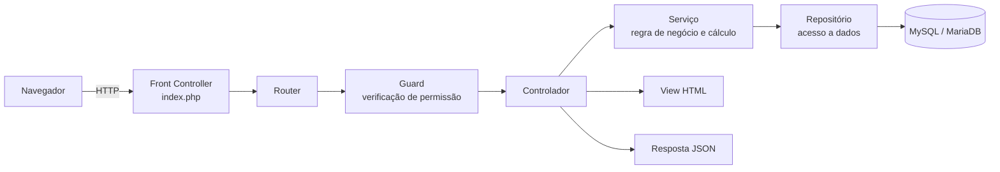

<div align="center">

ESTADO DE SANTA CATARINA<br>
ESCOLA DE EDUCAÇÃO BÁSICA SÃO JOÃO BATISTA<br>
PROJETOS COMPUTACIONAIS

<br>

BRUNO DALTOÉ CATTO<br>
GABRIEL RENAN DA SILVA

<br>

# PLATAFORM STORES

**Gestão comercial multi-loja com indicadores de Matemática Financeira**

<br>

SÃO MIGUEL DO OESTE<br>
2026

</div>

---

## Sumário

1. [Introdução](#1-introdução)
   - [1.1 Contextualização](#11-contextualização)
   - [1.2 Problema](#12-problema)
   - [1.3 Justificativa](#13-justificativa)
   - [1.4 Objetivos](#14-objetivos)
   - [1.5 Delimitação](#15-delimitação)
2. [Referencial teórico](#2-referencial-teórico)
   - [2.1 Fundamentação em Matemática Financeira](#21-fundamentação-em-matemática-financeira)
   - [2.2 Fundamentação tecnológica](#22-fundamentação-tecnológica)
3. [Metodologia](#3-metodologia)
   - [3.1 Tecnologias utilizadas](#31-tecnologias-utilizadas)
   - [3.2 Arquitetura do projeto](#32-arquitetura-do-projeto)
   - [3.3 A interdisciplinaridade na prática](#33-a-interdisciplinaridade-na-prática)
4. [Desenvolvimento e resultados](#4-desenvolvimento-e-resultados)
   - [4.1 O software em funcionamento](#41-o-software-em-funcionamento)
   - [4.2 Testes realizados](#42-testes-realizados)
   - [4.3 Análise dos resultados](#43-análise-dos-resultados)
5. [Considerações finais](#5-considerações-finais)
   - [5.1 Desafios](#51-desafios)
   - [5.2 Limitações atuais](#52-limitações-atuais)
   - [5.3 Sugestões de trabalhos futuros](#53-sugestões-de-trabalhos-futuros)
- [Referências](#referências)

---

# 1 Introdução

## 1.1 Contextualização

Na escola, a Matemática Financeira aparece em exercícios fechados: dado o custo e a margem desejada, calcule o preço de venda; dado o faturamento de dois meses, calcule quanto ele cresceu. São contas de uma linha, resolvidas uma vez. Para quem tem uma loja, essas mesmas contas precisam ser refeitas o tempo todo, para dezenas ou centenas de produtos, a cada venda.

Foi esse o ponto de partida do projeto. Construímos uma plataforma web de comércio, a Plataform Stores, em que cada venda registrada, seja pela loja virtual, seja pelo balcão, alimenta automaticamente um painel de indicadores financeiros que chamamos de Analyzing BI. A receita, o lucro, a margem, o ticket médio e a variação entre meses deixam de ser exercícios isolados e passam a ser calculados pelo próprio sistema e exibidos em gráficos.

## 1.2 Problema

O pequeno comerciante conhece bem a rotina da loja, mas raramente tem como medir o próprio negócio. Durante o levantamento, identificamos cinco dificuldades ligadas diretamente à Matemática Financeira:

- **Faturamento confundido com lucro.** O lojista sabe quanto entrou no caixa, mas não desconta o custo da mercadoria. Às vezes o produto que mais vende é justamente o que menos dá lucro.
- **Margem calculada "por alto".** Sem o preço de custo registrado ao lado do preço de venda, a margem vira estimativa.
- **Média simples no lugar da ponderada.** O preço médio de um produto vendido parte em promoção e parte a preço cheio depende de quantas unidades saíram em cada preço.
- **Nenhuma comparação entre períodos.** A taxa de variação de um mês para o outro, o diagnóstico mais simples de tendência, quase nunca é feita no caderno.
- **Decisões sem critério numérico.** Repor estoque, fazer promoção ou destacar um item são decisões tomadas no "feeling".

Existe ainda um problema anterior a todos esses: o dado de origem não é confiável. O estoque do balcão diverge do estoque da loja virtual, o caixa é controlado de modo informal e não há separação entre quem gerencia e quem apenas opera a loja. Sem dado confiável, nenhuma fórmula produz resultado útil.

## 1.3 Justificativa

Um sistema resolve as duas camadas do problema de uma só vez. Primeiro, ele registra cada venda de forma completa (valor, custo, quantidade, data e responsável) em uma base única, compartilhada pela loja virtual e pelo balcão. Depois, aplica sobre esses registros as fórmulas da Matemática Financeira e mostra o resultado de um jeito que qualquer lojista consegue ler.

Para nós, como estudantes, o ganho é que cada indicador corresponde a uma fórmula escrita no código. Dá para conferir o conceito em três níveis: a fórmula no papel, a consulta SQL que a calcula e o gráfico que a mostra. Além disso, o sistema roda sobre ferramentas gratuitas (PHP, MySQL e Apache, pelo XAMPP), sem mensalidade, e uma única instalação atende várias lojas independentes.

## 1.4 Objetivos

### 1.4.1 Objetivo geral

Desenvolver uma aplicação web multi-loja de gestão comercial que registre com segurança as vendas feitas pela internet e pelo balcão e que aplique automaticamente sobre esses dados os conceitos da Matemática Financeira, apresentando receita, custo, lucro, margem, ticket médio, taxa de variação e metas em um painel com gráficos e recomendações.

### 1.4.2 Objetivos específicos

1. Levantar os conceitos de Matemática Financeira aplicáveis ao varejo e definir a fórmula de cada indicador.
2. Modelar um banco de dados relacional em que todo indicador seja calculável, guardando preço praticado, custo, quantidade, data e responsável.
3. Desenvolver a vitrine pública (catálogo, variações de cor e tamanho, carrinho e checkout) e o ponto de venda (PDV) com controle de caixa por turno.
4. Garantir a integridade do estoque com transações e bloqueio de linha, impedindo que vendas simultâneas deixem o estoque negativo.
5. Implementar controle de acesso por cargo, separando quem vê os indicadores financeiros de quem só opera a loja.
6. Implementar no módulo Analyzing BI os cálculos de receita, lucro, preço médio ponderado, ticket médio, variação percentual, produtos parados, série temporal de faturamento com linha de tendência e metas.
7. Aplicar juros compostos no PDV por meio de um simulador de parcelamento pela tabela Price.
8. Validar os cálculos com teste de mesa feito à mão, testes automatizados e uma conferência com grande volume de dados.

## 1.5 Delimitação

Três limites marcam o escopo deste trabalho. O pagamento é simulado: o sistema registra, confirma e dá baixa no estoque, mas não movimenta dinheiro de verdade. E o valor do dinheiro no tempo foi aplicado apenas ao parcelamento (tabela Price no PDV); desconto à vista, VPL e TIR ficaram no referencial teórico. A projeção de tendência é linear, sem tratar sazonalidade.

---

# 2 Referencial teórico

## 2.1 Fundamentação em Matemática Financeira

A Matemática Financeira estuda as relações entre quantias de dinheiro, taxas percentuais e tempo (HAZZAN; POMPEO, 2014). Apresentamos aqui só os conceitos que o sistema usa.

### 2.1.1 Porcentagem e taxa de variação

A porcentagem é uma razão com denominador 100. Um acréscimo de taxa *i* sobre um valor *V* resulta em V·(1 + i), e um desconto resulta em V·(1 − i). Aumentos sucessivos se multiplicam em vez de se somar: dois aumentos de 10% equivalem a 1,10 × 1,10 = 1,21, ou seja, 21%.

A taxa de variação mede quanto uma grandeza mudou entre um valor inicial Vi e um valor final Vf:

```
i = (Vf − Vi) / Vi × 100
```

Se uma loja faturou R$ 8.000,00 em um mês e R$ 9.200,00 no seguinte, a variação é (9.200 − 8.000) / 8.000 = 15%. A fórmula não tem resultado quando Vi = 0. No papel isso é só uma observação; no sistema, como veremos, precisou virar uma regra.

### 2.1.2 Média simples e média ponderada

A média simples soma os valores e divide pela quantidade. A ponderada dá a cada valor um peso:

```
x̄ = Σ (xᵢ · pᵢ) / Σ pᵢ
```

Exemplo: 10 unidades vendidas a R$ 50,00 e 30 unidades a R$ 40,00. A média simples dos preços seria R$ 45,00, mas o preço médio real é (10 × 50 + 30 × 40) / 40 = R$ 42,50, porque a maior parte saiu pelo preço menor. Usar a média simples aqui superestima o faturamento em R$ 2,50 por unidade.

### 2.1.3 Receita, custo, lucro, margem e markup

A receita bruta (R) é a soma de preço de venda × quantidade de cada item vendido. O custo da mercadoria vendida (CMV) é a soma de preço de custo × quantidade. O lucro bruto é a diferença:

```
L = R − CMV = Σ qᵢ · (pvᵢ − pcᵢ)
```

O frete cobrado do cliente não faz parte de R: ele não é venda de mercadoria e não tem CMV. Se entrasse na receita, a igualdade acima deixaria de valer em todo pedido com entrega.

A diferença pv − pc é a margem unitária: quanto cada unidade contribui para o resultado. Um erro comum no pequeno comércio é confundir margem com markup, que usam o mesmo numerador, mas bases diferentes (ASSAF NETO, 2016):

**Quadro 1 – Markup e margem**

| Indicador | Fórmula | Exemplo (pc = 60, pv = 100) |
|---|---|---|
| Markup (sobre o custo) | (pv − pc) / pc | 40 / 60 = 66,67% |
| Margem (sobre a venda) | (pv − pc) / pv | 40 / 100 = 40,00% |

Fonte: os autores (2026).

### 2.1.4 Indicadores do varejo

Sobre essas grandezas se constroem os indicadores de gestão. O ticket médio é a receita dividida pelo número de vendas (TM = R / n). O ponto de reposição avisa quando o estoque chega ao mínimo definido. A repartição proporcional divide um total T entre participantes segundo pesos; com pesos iguais, cada um recebe T / n, que é a forma mais simples de dividir uma meta entre a equipe.

Outros indicadores olham para o produto. O capital em estoque é o dinheiro aplicado em mercadoria (C = Σ q × pc). O giro mostra quantas vezes esse valor foi vendido em um período (G = CMV / estoque a custo). A cobertura projeta por quantos dias o estoque dura no ritmo atual de venda (D = estoque / venda média diária). A Curva ABC aplica o princípio de Pareto ao faturamento: poucos itens costumam concentrar a maior parte da receita, então eles são separados em classes A, B e C para receber mais atenção.

### 2.1.5 Séries temporais

Quando um indicador é observado dia após dia, forma-se uma série temporal. Para ler a tendência corretamente, os intervalos precisam ser regulares: um dia sem vendas tem de aparecer como zero, e não sumir do gráfico. As técnicas mais simples de projeção são a média móvel e a reta de tendência pelos mínimos quadrados. Nesta, numeram-se os períodos x = 0, 1, …, n − 1 e procura-se a reta ŷ = a + b·x que deixa a menor soma dos quadrados dos desvios:

```
b = Σ (x − x̄)(y − ȳ) / Σ (x − x̄)²        a = ȳ − b·x̄
```

O coeficiente de determinação R² = 1 − Σ (y − ŷ)² / Σ (y − ȳ)² indica quanto da variação a reta explica: 1 é ajuste perfeito, e perto de 0 a reta não diz muito além da média.

### 2.1.6 Juros simples e compostos

Nos juros simples, o juro de cada período incide sempre sobre o capital inicial: M = C·(1 + i·n). Nos compostos, o juro de um período passa a render no período seguinte: M = C·(1 + i)ⁿ. Com R$ 1.000,00 a 2% ao mês por 12 meses, o regime simples gera R$ 1.240,00 e o composto, R$ 1.268,24. A taxa mensal equivalente a uma taxa anual também segue a regra composta: (1 + i)¹² − 1.

No parcelamento pela tabela Price (sistema francês de amortização), as parcelas são iguais e os juros incidem sobre o saldo devedor. A parcela de um valor P em n vezes, à taxa i, é (PUCCINI, 2011):

```
PMT = P · i / (1 − (1 + i)⁻ⁿ)
```

A cada mês, os juros são saldo × i, a amortização é PMT − juros e o saldo diminui; por isso os juros caem e a amortização cresce até o saldo zerar. Com R$ 1.000,00 a 2% ao mês em 12 vezes, a parcela é R$ 94,56 e o total pago, R$ 1.134,72. É esse o parcelamento implementado no PDV. Desconto à vista, VPL e TIR, que vêm do mesmo princípio, ficaram para trabalhos futuros.

## 2.2 Fundamentação tecnológica

### 2.2.1 Aplicação web e PHP

Uma aplicação web roda em um servidor e é acessada pelo navegador, no modelo cliente-servidor. A comunicação usa o protocolo HTTP, em ciclos de requisição e resposta. Como o HTTP não guarda memória entre uma requisição e outra, o sistema usa sessão para saber quem está conectado.

O PHP é uma linguagem interpretada que roda no servidor e é voltada para a web (PHP GROUP, 2026). A partir da versão 8 ela tem tipagem declarada e orientação a objetos madura, o que nos permitiu colocar cada fórmula em um método próprio, com tipos definidos. No navegador, usamos HTML para a estrutura, CSS para a aparência e JavaScript para o comportamento, incluindo as requisições assíncronas (fetch) que atualizam o painel sem recarregar a página.

### 2.2.2 Banco de dados relacional e SQL

O modelo relacional organiza os dados em tabelas ligadas por chaves primárias e estrangeiras (CODD, 1970; ELMASRI; NAVATHE, 2019). A linguagem SQL tem funções de agregação que correspondem diretamente às operações da Matemática Financeira:

**Quadro 2 – Correspondência entre Matemática Financeira e SQL**

| Conceito matemático | Recurso SQL |
|---|---|
| Somatório Σ | `SUM()` com `GROUP BY` |
| Contagem n | `COUNT(*)` |
| Média ponderada | `SUM(valor × peso) / SUM(peso)` |
| Receita − custo | Custo gravado no item vendido (`order_items.cost_price`), com o cadastro do produto como reserva |
| Divisão por zero | `CASE WHEN … THEN … ELSE 0 END` |

Fonte: os autores (2026).

Para valores em dinheiro usamos o tipo `DECIMAL`. O tipo de ponto flutuante não representa exatamente certas frações decimais (0,1 + 0,2 resulta em 0,30000000000000004), e esse desvio se acumula em centavos.

### 2.2.3 Transações e concorrência

Uma transação agrupa várias operações que precisam acontecer juntas: ou todas são confirmadas (`COMMIT`), ou nenhuma (`ROLLBACK`). Essas garantias são resumidas na sigla ACID: atomicidade, consistência, isolamento e durabilidade (HÄRDER; REUTER, 1983). Quando duas vendas leem o mesmo estoque ao mesmo tempo, ambas podem achar que há produto suficiente, o que se chama condição de corrida. A solução usual é o bloqueio de linha (`SELECT … FOR UPDATE`), que faz a segunda operação esperar a primeira terminar.

### 2.2.4 Arquitetura em camadas e segurança

Separar o código em camadas (rotas, controladores, serviços e repositórios) deixa cada parte com uma responsabilidade só (PRESSMAN; MAXIM, 2016). Na prática, isso significa que a fórmula de um indicador fica em um único lugar. Do lado da segurança, usamos senhas guardadas como hash, controle de acesso por papéis (RBAC) com negação por padrão, token contra CSRF, instruções preparadas do PDO contra injeção de SQL e limite de tentativas de login.

### 2.2.5 Business Intelligence e visualização

Business Intelligence (BI) é o conjunto de técnicas que transforma dados operacionais em informação para decisão (KIMBALL; ROSS, 2013). Os indicadores-chave são reunidos em painéis, e cada tipo de gráfico serve a uma comparação: linha para evolução no tempo, barras para comparar itens entre si (FEW, 2006).

---

# 3 Metodologia

Trabalhamos de forma incremental: primeiro um núcleo mínimo funcionando, depois um módulo por vez, cada um testado antes de servir de base para o próximo. A ordem foi imposta pelos próprios dados. O módulo de indicadores depende de vendas registradas com preço, custo, quantidade e data, então cadastro, vitrine, PDV e controle de estoque vieram antes do BI.

## 3.1 Tecnologias utilizadas

**Quadro 3 – Tecnologias e motivo da escolha**

| Tecnologia | Por que escolhemos |
|---|---|
| PHP 8 | Gratuito, presente em praticamente toda hospedagem, com tipagem e orientação a objetos. |
| MySQL / MariaDB | Banco relacional com transações e bloqueio de linha; as funções de agregação fazem os somatórios (ORACLE CORPORATION, 2026). |
| Apache + XAMPP | Reúne servidor web, PHP e banco em uma instalação; o mod_rewrite permite URLs legíveis como `/painel/minha-loja`. |
| HTML, CSS e JavaScript puro | Sem framework, para evitar etapa de compilação e deixar visível a lógica dos gráficos. Tema claro/escuro com variáveis CSS. |
| Chart.js 4.4.1 | Gráfico de linha do faturamento, carregado por CDN (CHART.JS, 2026). |
| RapidAPI e OpenRouter (opcionais) | Geração do QR Code do PIX, no padrão do Banco Central (BANCO CENTRAL DO BRASIL, 2026), e assistente de IA que comenta os indicadores. O sistema funciona sem eles. |
| Git e GitHub | Controle de versão, adotado depois que perdemos o código uma vez. |
| VS Code, phpMyAdmin, PHPStan | Edição, inspeção do banco e análise estática do código. |
| Inteligência Artificial | Claude (ANTHROPIC, 2026): apoio na estruturação do código, na revisão e na redação da documentação. |

Fonte: os autores (2026).

O projeto tem um `composer.json` com carregamento automático no padrão PSR-4 e ferramentas de desenvolvimento (PHPStan e php-cs-fixer). Mesmo assim, ele roda sem o Composer instalado: o arquivo `backend/bootstrap.php` usa o carregador do Composer quando a pasta `vendor/` existe e, se ela não existir, registra um carregador próprio. Assim, para instalar basta copiar a pasta e criar o banco.

## 3.2 Arquitetura do projeto

O sistema é multi-loja: cada loja é identificada por um *slug* na URL, e toda consulta ao banco é filtrada pelo identificador da loja. Assim, os números de uma loja nunca aparecem em outra. Há três áreas de acesso:

**Quadro 4 – Áreas do sistema**

| Área | Endereço | Quem usa |
|---|---|---|
| Plataforma | `/`, `/lojas`, `/criar-loja` | Qualquer usuário cadastrado |
| Vitrine | `/loja/{slug}/…` | Cliente final (navega livre, compra com login) |
| Painel | `/painel/{slug}/…` | Equipe da loja, com acesso por cargo |

Fonte: os autores (2026).

Toda requisição segue o mesmo caminho. Ela chega a um arquivo de entrada único (*front controller*); o Router descobre qual ação corresponde ao endereço; o Guard confere se o usuário tem a permissão que a rota exige; o controlador valida a entrada; o serviço aplica a regra de negócio e faz os cálculos; o repositório conversa com o banco. A resposta é uma página HTML ou um JSON consumido pelo JavaScript.

A decisão mais importante para este trabalho foi isolar as fórmulas financeiras em [backend/app/Services/AnalyzingBIService.php](backend/app/Services/AnalyzingBIService.php) e as consultas de agregação em [backend/app/Repositories/AnalyzingBIRepository.php](backend/app/Repositories/AnalyzingBIRepository.php). Qualquer fórmula pode ser encontrada, conferida e corrigida em um só lugar.

**Figura 1 – Caminho de uma requisição pelas camadas do sistema**



Fonte: os autores (2026).

### 3.2.1 Modelagem de dados

O banco tem 23 tabelas e foi desenhado a partir das fórmulas: cada grandeza que aparece em uma conta precisava existir como coluna. As principais estão no Quadro 5.

**Quadro 5 – Tabelas centrais para o cálculo financeiro**

| Tabela | Colunas que importam para os indicadores |
|---|---|
| `products` | `sale_price` (preço de venda), `cost_price` (preço de custo), `stock_quantity`, `min_stock` |
| `product_variants` | estoque por variação de cor e tamanho |
| `orders` | `total` (itens − descontos + frete), `discount` (desconto do balcão, cupom e PIX), `shipping_fee` (frete), `status` (pendente, pago, cancelado ou estornado), `order_type` (online ou pdv), `created_at` |
| `order_items` | `quantity`, `price` e `cost_price`: preço e custo no momento da venda |
| `payments` | forma (dinheiro, cartão, PIX), situação e valor |
| `cash_registers` / `cash_movements` | abertura, fechamento, entradas e saídas do caixa |
| `store_goals` / `employee_goals` | valor da meta e período |

Fonte: os autores (2026).

Uma escolha merece destaque: preço e custo ficam gravados no item do pedido (`order_items.price` e `order_items.cost_price`) no momento da venda. Se o cálculo buscasse os valores atuais do produto, um reajuste hoje alteraria o faturamento e o lucro de meses passados. Pedidos antigos, anteriores a essa coluna, usam o custo do cadastro; se nenhum existir, o custo é considerado zero.

### 3.2.2 Design da interface

Vitrine e painel compartilham a mesma folha de estilo, mas têm propósitos diferentes: a vitrine tem cara de loja virtual, e o painel, de ferramenta de trabalho. As telas são responsivas, porque o PDV costuma ser usado no celular ou no tablet, e há tema claro e escuro. No Analyzing BI, cada informação ganhou a representação adequada: cartões para números globais, linha para o faturamento no tempo, barras para o lucro por produto e listas sinalizadas para os itens que pedem uma decisão.

## 3.3 A interdisciplinaridade na prática

Esta seção mostra como cada fórmula do Capítulo 2 foi escrita em código. Os trechos foram tirados do código-fonte do projeto.

### 3.3.1 Receita bruta: o somatório vira SUM()

A receita é a soma do total dos pedidos pagos, sem o frete (R = Σ (total − frete)). O filtro `status = 'pago'` garante que só entram vendas concretizadas, e as datas definem o período:

```sql
SELECT COALESCE(SUM(total - shipping_fee), 0) FROM orders
WHERE store_id = ? AND status = 'pago'
  AND created_at >= ? AND created_at <= ?
```

O frete precisa ser subtraído porque `orders.total` é o valor que o cliente paga pelo pedido, e isso inclui a entrega. Quando o frete foi implementado, ele passou a entrar no faturamento e no ticket médio, mas não no lucro, que é calculado pelos itens. A conta L = R − CMV deixou de fechar nos pedidos com entrega, e foi assim que o erro apareceu. Os juros do parcelamento não têm esse problema: ficam na tabela `payments` e não alteram `orders.total`.

### 3.3.2 Lucro bruto

A fórmula L = Σ qᵢ · (pvᵢ − pcᵢ) foi transcrita quase literalmente. Preço e custo vêm do próprio item vendido; o `COALESCE` trata o item sem custo informado:

```sql
SELECT COALESCE(SUM(
    oi.quantity * (oi.price - COALESCE(oi.cost_price, p.cost_price, 0))
    - <desconto rateado do item>), 0)
FROM order_items oi
INNER JOIN orders o ON o.id = oi.order_id AND o.store_id = ? AND o.status = 'pago'
LEFT JOIN products p ON p.id = oi.product_id
```

A correspondência é termo a termo: Σ vira `SUM`, qᵢ vira `oi.quantity`, pvᵢ vira `oi.price` e pcᵢ vira `oi.cost_price`. O custo usado é o congelado na venda. Quando o pedido tem desconto, ele é rateado entre os itens na proporção do valor de cada um (desconto × valor do item ÷ subtotal do pedido), que é a repartição proporcional do Capítulo 2 aplicada de novo. Assim, a soma dos lucros por produto continua fechando com o lucro total.

### 3.3.3 Preço médio ponderado

A média ponderada é o quociente entre dois somatórios. O `CASE WHEN` impede a divisão por zero:

```sql
CASE WHEN SUM(oi.quantity) > 0
     THEN (SUM(oi.quantity * oi.price) - SUM(<desconto rateado do item>))
          / SUM(oi.quantity)
     ELSE 0 END AS preco_venda_medio
```

Se tivéssemos usado `AVG(oi.price)`, que é a média simples, o resultado sairia errado sempre que um produto fosse vendido a preços diferentes em quantidades diferentes. O desconto rateado sai também do preço médio, para que margem = preço médio − custo médio continue fechando com o lucro do produto.

### 3.3.4 Ticket médio

A divisão é feita em PHP, na camada de serviço, com proteção para a loja que ainda não vendeu nada:

```php
$valorTotal = $this->repo->sumPaidOrdersTotal($storeId, null, null);
$quantidadePedidos = $this->repo->countPaidOrders($storeId, null, null);
$ticketMedio = $quantidadePedidos > 0 ? $valorTotal / $quantidadePedidos : 0.0;
```

Como `sumPaidOrdersTotal` já desconta o frete, o ticket médio mede só o valor em mercadorias de cada pedido.

### 3.3.5 Taxa de variação percentual

A fórmula ficou em uma função estática, para que todo o sistema compare períodos com o mesmo cálculo. O caso Vi = 0, que não tem resposta na Matemática, foi resolvido por convenção: se não havia venda e passou a haver, consideramos crescimento de 100%; se continua sem venda, 0%.

```php
public static function growthPercent(float $current, float $previous): float
{
    if ($previous == 0.0) {
        return $current > 0 ? 100.0 : 0.0;
    }
    return (($current - $previous) / $previous) * 100.0;
}
```

Foi aqui que mais aprendemos sobre os limites da fórmula. No caderno, escrevemos "indefinido" e seguimos em frente. O programa precisa mostrar alguma coisa na tela, então tivemos de escolher uma resposta e documentá-la.

Para os cartões de produto, porém, a convenção de +100% se mostrou enganosa: um item que vendeu 1 unidade contra 0 aparecia com "+100%", como se tivesse dobrado. Por isso criamos `productGrowth()`, que devolve "sem base de comparação" quando o mês anterior é zero. O faturamento da loja continua usando a convenção.

Também corrigimos o período comparado. O mês atual, ainda incompleto, era comparado com o mês anterior inteiro, o que mostrava "queda de 88%" todo começo de mês. Hoje o sistema compara do dia 1º até agora com o mesmo intervalo do mês anterior.

### 3.3.6 Produtos parados: regra por proporção

Um produto é sinalizado como parado em três situações, da mais grave para a menos grave. As duas primeiras valem para produtos com estoque: nunca vendeu e está no cadastro há pelo menos 30 dias, ou está há pelo menos 30 dias sem vender. A terceira é a queda: vendeu pelo menos uma unidade no mês anterior e, no mês atual, vendeu menos de 25% daquele volume. A comparação usa o mesmo período decorrido do mês anterior, e não o mês inteiro. O limite mínimo de uma unidade evita que a regra dependa de frações sem sentido para quantidades pequenas:

```php
if ($qp < 1) { continue; }            // só produtos que venderam no mês anterior
$limite = max(1.0, $qp * 0.25);
if ($qc < $limite) { /* sinaliza como parado */ }
```

Só a regra da queda deixaria de fora justamente o pior caso, o produto que nunca vendeu. Nas duas primeiras situações, o sistema também mostra o capital parado, isto é, o estoque multiplicado pelo custo do cadastro (C = q × pc), e lista primeiro os produtos que prendem mais dinheiro. Um produto em mais de uma situação aparece só uma vez, na mais grave.

### 3.3.7 Repartição das metas

A meta da loja cobre todas as vendas, mas o vendido de cada funcionário conta só as vendas registradas no nome dele. A vitrine e as vendas do gerente não contam para ninguém da equipe. Por isso, dividir a meta inteira seria injusto: com meta de R$ 10.000,00 e R$ 6.000,00 vendidos pela vitrine, a loja poderia bater 100% com todos os funcionários abaixo da meta.

Assim, o gerente informa qual parte T da meta será dividida. O sistema sugere um valor proporcional ao que os funcionários venderam nos três meses anteriores: com R$ 10.000,00 de meta e 40% das vendas feitas por eles, a sugestão é de R$ 4.000,00. O vendido da loja também é mostrado separado em funcionários, gerente e vitrine, e as três partes somam o total.

O valor T é dividido igualmente entre os funcionários, aplicando P = T / n. O gerente define a meta e não entra na divisão. Dividir R$ 1.000,00 entre 3 com arredondamento dá 3 × 333,33 = R$ 999,99, e um centavo some. Por isso a divisão é feita em centavos (`Money::splitEvenly`): o resto vai, um centavo por vez, para as primeiras partes:

```
base    = floor(T / n)        // em centavos
resto   = T - base * n        // 0 <= resto < n
parte_k = base + 1 para k < resto; base nos demais
```

O resultado é R$ 333,34 + 333,33 + 333,33 = R$ 1.000,00. Assim a soma fecha sempre e as partes nunca diferem em mais de um centavo.

### 3.3.8 Série temporal sem buracos

O banco devolve apenas os dias em que houve venda. Se plotássemos isso direto, os dias sem faturamento sumiriam do eixo e a linha ficaria enganosa. Por isso um laço percorre todos os dias do intervalo e coloca zero nos que faltam. O período pode ser de 7 dias, 30 dias (agrupados por dia) ou 3 meses (agrupados por mês).

```php
$cur = $start;
while ($cur <= $end) {
    $key = $cur->format('Y-m-d');
    $out[] = ['data' => $key, 'valor' => round($map[$key] ?? 0.0, 2)];
    $cur = $cur->modify('+1 day');
}
```

### 3.3.9 Linha de tendência por mínimos quadrados

A projeção do faturamento usa a regressão linear do Capítulo 2, implementada em `App\Domain\Finance\Trend`. Um cuidado prático: a reta é ajustada só com períodos completos. O dia de hoje (ou o mês corrente) ainda não terminou, e esse valor parcial no fim da série puxaria a inclinação para baixo, mostrando queda toda manhã. O período corrente entra na projeção, não no ajuste. Faturamento também não pode ser negativo, então uma reta de queda que cruze o zero é cortada em zero.

```php
$b  = $sxx > 0 ? $sxy / $sxx : 0.0;          // inclinação
$a  = $yMedio - $b * $xMedio;                // intercepto
$r2 = $sqTot > 0 ? 1 - $sqRes / $sqTot : 1.0;
// projeção: max(0, a + b·x) para os próximos períodos
```

São exigidos pelo menos 3 pontos, e sem nenhuma venda no período de ajuste o sistema não desenha a reta. No gráfico, os períodos projetados aparecem como linha tracejada, continuando a linha real. O teste de mesa usado nos testes automatizados serve de exemplo: com y = [1, 3, 2, 5, 4], o resultado é b = 0,8, a = 1,4 e R² = 0,64.

### 3.3.10 Parcelamento pela tabela Price

No PDV, ao escolher cartão, o operador informa o número de parcelas e a taxa mensal e vê na hora o valor da parcela, o total e os juros. O cálculo é feito no servidor (`App\Domain\Finance\Installments`), com a fórmula PMT do Capítulo 2. Cada valor é arredondado ao centavo, como numa fatura real; o resíduo acumulado vai para a última parcela, que amortiza exatamente o saldo restante, para que a tabela sempre feche. Com taxa zero, a conta volta a ser a divisão em partes iguais em centavos. O sistema também mostra a taxa anual equivalente, (1 + i)¹² − 1.

```php
$coef    = $i / (1 - (1 + $i) ** (-$parcelas));   // i / (1 − (1+i)^−n)
$pmtCent = (int) round($principalCent * $coef);
```

### 3.3.11 Integridade do dado

Confirmar um pagamento envolve três mudanças: marcar o pagamento como confirmado, marcar o pedido como pago e dar baixa no estoque. Se uma delas falhar no meio, o banco fica inconsistente e todo indicador calculado depois sai errado. Por isso as três rodam em uma única transação, com a linha do pagamento travada até o fim (`OrderService.php`):

```php
return Database::transaction(
    fn (): array => $this->confirmPaymentInTransaction($paymentId, $storeId)
);
// dentro da transação:
$payment = $this->paymentRepo->findForUpdate($paymentId); // SELECT ... FOR UPDATE
```

Essa é a ligação menos óbvia entre as duas disciplinas. A Matemática Financeira fornece a fórmula, mas é a Computação que garante que os números colocados nela sejam verdadeiros. Uma margem bem calculada sobre um estoque baixado duas vezes continua sendo um número errado.

### 3.3.12 Margem e markup em percentual

A distinção do Quadro 1 agora aparece no painel. A margem usa a receita como base, e o markup usa o custo. Como L = R − CMV, os dois saem das grandezas que o sistema já calcula, com o desconto rateado e o custo congelado na venda:

```php
public static function marginPercent(float $receita, float $lucro): ?float
{
    return $receita > 0 ? round($lucro / $receita * 100, 2) : null;
}

public static function markupPercent(float $custo, float $lucro): ?float
{
    return $custo > 0 ? round($lucro / $custo * 100, 2) : null;
}
```

Sem base, a função devolve `null` e a tela mostra um traço. Um produto sem custo registrado não tem markup, e mostrar 0% seria falso.

### 3.3.13 Curva ABC

Os produtos são ordenados pelo faturamento dos últimos 12 meses, e cada um recebe o percentual acumulado. A classe depende do acumulado **antes** do item: até 80%, classe A; até 95%, classe B; depois, classe C. Olhar o acumulado anterior garante que o item que cruza os 80% continue na classe A; caso contrário, um único produto com 90% da receita ficaria fora dela.

Com receitas de 700, 150, 100 e 50 (total de 1.000), os acumulados são 70%, 85%, 95% e 100%, e as classes são A, A, B e C. A curva classifica só pelo faturamento, então a tabela mostra a margem ao lado: um item da classe A pode vender muito e render pouco. A conferência com grande volume verifica que a soma da receita da curva é igual ao faturamento do período.

### 3.3.14 Capital, giro e cobertura de estoque

O capital em estoque é Σ estoque × custo atual do cadastro. Produto com estoque e sem custo entra com zero, então o sistema avisa quantos estão nessa situação, porque o total fica abaixo do real. Capital em estoque não é o mesmo que capital parado: a tela separa o total do valor preso em produtos sem venda há pelo menos 30 dias.

A cobertura divide o estoque pela venda média diária dos últimos 90 dias, ou do período de vida do produto, se ele for mais novo. Com 30 unidades em estoque e 60 vendidas em 90 dias, a venda é de 2/3 por dia e o estoque dura 45 dias. A data de reposição usa a mesma conta até o estoque mínimo, não até zero: com mínimo de 10, faltam 20 unidades, ou 30 dias.

Há duas aproximações, indicadas na tela. O giro usa o estoque atual no denominador, e não o estoque médio, que o sistema não guarda. A projeção também não conhece o prazo do fornecedor, então a data é quando o estoque chega ao mínimo, e não quando o pedido de compra deve ser feito.

### 3.3.15 Cupons e estorno na receita

Para cada cupom, o BI mostra pedidos, desconto, receita, lucro e margem dos últimos 90 dias e compara os pedidos com e sem cupom. Essa comparação descreve os dois grupos, mas não mede quanto o cupom fez vender a mais: não há como saber quem compraria igual sem o desconto. Medir o efeito exigiria um experimento com grupo de controle.

O estorno muda a situação do pedido para "estornado". Como todas as consultas somam apenas pedidos pagos, a venda sai da receita, do lucro e das metas sem nenhuma fórmula nova. A consequência é que o valor sai do mês em que a venda aconteceu, e um mês já encerrado pode mudar. A contabilidade costuma registrar a devolução no mês em que ela ocorre; aqui, a escolha mantém L = R − CMV válido em qualquer período.

### 3.3.16 Do número à decisão

Os indicadores chegam ao navegador em JSON. O faturamento vira gráfico de linha (Chart.js); o lucro por produto vira gráfico de barras feito em HTML e CSS, em que a altura de cada barra é a razão entre o lucro do item e o maior lucro do conjunto. Por fim, o sistema gera frases de recomendação: se o faturamento do mês cresceu mais de 1% em relação ao anterior, sugere reforçar o estoque dos campeões; se caiu mais de 1%, sugere rever campanhas ou o mix de produtos.

---

# 4 Desenvolvimento e resultados

O resultado é uma aplicação que funciona de ponta a ponta: cadastro da loja e dos produtos, vitrine, compra, pagamento, baixa de estoque, controle de caixa e, no final, os indicadores financeiros calculados sobre tudo isso.

**Quadro 6 – O sistema em números**

| Item | Quantidade |
|---|---|
| Telas | 26 (6 da plataforma, 8 da vitrine, 12 do painel) |
| Tabelas no banco | 23 |
| Migrações de banco versionadas | 24 |
| Cargos | 2 (gerente e funcionário), sobre matriz de permissões |
| Testes automatizados | 125, todos passando |

Fonte: os autores (2026).

## 4.1 O software em funcionamento

### 4.1.1 Plataforma

O usuário entra pelo login, vê as lojas de que participa e pode criar uma nova. Uma mesma pessoa pode ser gerente de uma loja e funcionária de outra, com um cadastro só. A exclusão da conta é recusada pelo servidor quando há pedidos ou movimentos de caixa ligados a ela, para não apagar histórico financeiro.

### 4.1.2 Vitrine

A vitrine (`/loja/{slug}`) tem catálogo com banner, categorias e busca, página de produto com galeria e escolha de cor e tamanho, carrinho, checkout com retirada ou entrega, comprovante do pedido, histórico de compras e cadastro de endereços. Navegar e montar o carrinho não exige conta; finalizar a compra, sim. A identidade do comprador vem sempre da sessão, nunca de um parâmetro da URL, para que ninguém consiga ver o pedido de outra pessoa trocando um número no endereço.

### 4.1.3 Painel

O painel (`/painel/{slug}`) reúne dashboard do dia, cadastro de produtos com preço de venda e de custo, estoque por variação com histórico, quadro de entregas em formato Kanban, PDV, vendas e estornos, clientes, metas de venda, funcionários, hierarquia de cargos, configurações (identidade visual e chave PIX) e o Analyzing BI. PDV e vitrine usam o mesmo estoque e a mesma tabela de pedidos: uma venda no balcão reduz na hora a quantidade disponível na loja virtual.

O PDV foi refeito para o ritmo do balcão: tem atalhos de teclado, desconto no pedido (em reais ou em porcentagem), cálculo de troco e emissão de cupom. No pagamento com cartão, há um simulador de parcelamento pela tabela Price que mostra a parcela, o total, os juros e a tabela de amortização mês a mês.

O funcionário opera a loja (PDV, caixa e entregas), mas não a gerencia. Catálogo, equipe, configurações e BI são do gerente, e o funcionário também não recebe o custo dos produtos nem o faturamento da loja, seja nas respostas da API, seja no contexto do assistente de IA. Essa regra fica no servidor, em uma matriz de permissões consultada antes de qualquer controlador. Esconder botões na tela não basta, porque qualquer um pode chamar o endereço da API diretamente.

Na tela de vendas, o gerente estorna um pedido pago informando o motivo e se as peças voltam ao estoque. Em uma única transação, pedido e pagamento mudam de situação, o uso do cupom é devolvido e o estoque é reposto na variação vendida. Como o pagamento é simulado, o sistema só registra o estorno; a exceção é a venda em dinheiro no balcão, que lança a saída no caixa aberto. O PDV também aceita leitor de código de barras, que funciona como um teclado: lê o código e tecla Enter. Cada variação tem o próprio código, porque cada tamanho é um item diferente na prateleira. A tela de clientes lista quem mais compra e quem não compra há 60 dias ou mais, considerando apenas compras da vitrine, já que a venda de balcão não identifica o cliente.

### 4.1.4 Analyzing BI

É a tela que concretiza o objetivo do trabalho. Ela mostra cartões com faturamento acumulado, faturamento do mês, lucro acumulado, lucro do mês, número de pedidos, ticket médio e percentual atingido da meta do mês, além da margem e do markup do mês; o gráfico de faturamento ao longo do tempo, com a projeção de tendência em linha tracejada; o lucro por produto no mês, com custo unitário, preço médio ponderado, margem unitária e lucro total; o produto mais e o menos vendido com a variação percentual (ou "sem base de comparação", quando o produto não vendeu no mês anterior); os produtos parados; o estoque crítico, que avisa quando o total chega ao mínimo e também quando uma variação zera, como o tamanho M acabar enquanto ainda há P e G; o capital em estoque; a Curva ABC com margem e markup por produto; o giro e a cobertura de estoque, com a data de reposição; o resultado dos cupons; e as ideias de investimento, como: "As vendas do mês cresceram 21,4% em relação ao mês anterior. Bom momento para reforçar estoque dos itens campeões."

## 4.2 Testes realizados

### 4.2.1 Teste de mesa dos indicadores

O teste principal foi calcular à mão o que o sistema deveria mostrar e comparar com o que ele mostrou. Usamos um conjunto pequeno de vendas, fácil de conferir:

**Quadro 7 – Vendas do mês usadas no teste**

| Produto | Custo | Preço praticado | Qtd. | Pedido |
|---|---|---|---|---|
| Camiseta | R$ 20,00 | R$ 50,00 | 2 | #1 |
| Calça | R$ 60,00 | R$ 120,00 | 1 | #2 |
| Boné | R$ 15,00 | R$ 35,00 | 1 | #2 |
| Camiseta (promoção) | R$ 20,00 | R$ 45,00 | 3 | #3 |
| Calça | R$ 60,00 | R$ 120,00 | 1 | #4 |

Fonte: os autores (2026).

**Quadro 8 – Cálculo manual e resultado esperado**

| Indicador | Desenvolvimento | Esperado |
|---|---|---|
| Receita bruta | 100 + 155 + 135 + 120 | R$ 510,00 |
| Pedidos pagos | contagem | 4 |
| Ticket médio | 510 ÷ 4 | R$ 127,50 |
| CMV | (5 × 20) + (2 × 60) + (1 × 15) | R$ 235,00 |
| Lucro bruto | 510 − 235 | R$ 275,00 |
| Lucro da Camiseta | 2 × (50 − 20) + 3 × (45 − 20) | R$ 135,00 |
| Lucro da Calça | 2 × (120 − 60) | R$ 120,00 |
| Lucro do Boné | 1 × (35 − 15) | R$ 20,00 |
| Preço médio da Camiseta | (2 × 50 + 3 × 45) ÷ 5 | R$ 47,00 |
| Margem unitária da Camiseta | 47,00 − 20,00 | R$ 27,00 |
| Variação sobre o mês anterior (R$ 420,00) | (510 − 420) ÷ 420 | +21,43% |

Fonte: os autores (2026).

O painel mostrou exatamente esses valores. Fizemos também uma verificação cruzada: o lucro calculado pela diferença entre receita e custo (510 − 235 = 275) bate com a soma dos lucros por produto (135 + 120 + 20 = 275). Os pedidos desse teste não têm frete. O caso com frete foi conferido em grande volume, na seção 4.2.4.

A Camiseta foi colocada no teste de propósito, para expor o erro da média simples. Pela média simples, o preço médio seria (50 + 45) ÷ 2 = R$ 47,50. O sistema mostrou R$ 47,00, que é a média ponderada correta. A diferença de R$ 0,50 por unidade, nas cinco unidades vendidas, daria R$ 2,50 de faturamento atribuído a mais ao produto.

### 4.2.2 Casos-limite

Testamos também as situações em que a fórmula não tem resposta matemática, que é onde os programas costumam quebrar:

**Quadro 9 – Comportamento nos casos-limite**

| Situação | Na Matemática | No sistema |
|---|---|---|
| Loja sem nenhuma venda | Ticket médio = 0 ÷ 0 | Mostra R$ 0,00, sem erro |
| Faturamento da loja: mês anterior zerado, atual com venda | (Vf − 0) ÷ 0 | Mostra +100% (convenção) |
| Cartão de produto: mês anterior zerado | (Vf − 0) ÷ 0 | Mostra "sem base de comparação" |
| Faturamento da loja: os dois meses zerados | (0 − 0) ÷ 0 | Mostra 0% |
| Produto sem custo | Margem indeterminada | Usa o custo gravado na venda; se não houver, o do cadastro; se não houver, zero |
| Dia sem venda no gráfico | Lacuna na série | Ponto com R$ 0,00 |
| Vendeu no mesmo período do mês passado e não vende neste | Queda de 100% | Aparece como produto parado |
| Tem estoque e nunca vendeu | Sem base para calcular a queda | Aparece como produto parado depois de 30 dias no cadastro |
| Meta do mês não definida | Realizado ÷ meta sem divisor | Mostra "sem meta", sem percentual |
| Produto sem custo registrado | Markup = lucro ÷ 0 | Mostra um traço e avisa no capital em estoque |
| Produto com estoque e sem venda em 90 dias | Cobertura = estoque ÷ 0 | Mostra "Sem venda em 90 dias", sem data de reposição |
| Produto que representa mais de 80% da receita | Cruza o limite da classe A | Continua na classe A |
| Estornar duas vezes o mesmo pedido | Devolveria as peças em dobro | A segunda tentativa é recusada |

Fonte: os autores (2026).

Sobre o produto sem custo: com custo zero, o lucro do item fica igual à receita. O número segue a fórmula, mas na prática está superestimado. A solução é preencher o custo no cadastro.

### 4.2.3 Testes de integridade, segurança e testes automatizados

**Quadro 10 – Verificações de integridade e acesso**

| Teste | Como foi feito | Resultado |
|---|---|---|
| Concorrência | `concurrency_check.php`: duas confirmações simultâneas do mesmo pagamento | Só uma passa; o estoque baixa uma vez |
| Rotas | `routes_check.php`: varre todas as rotas | Nenhuma rota roda sem declarar permissão |
| Permissões | `authz_check.php`: requisições HTTP reais com cada cargo | Funcionário é barrado no BI |
| CSRF | Requisição de alteração sem token | Recusada com código 403 |
| Login | Tentativas seguidas com senha errada | Bloqueio após 8 tentativas em 15 minutos |

Fonte: os autores (2026).

Além disso, o projeto tem uma suíte própria de 125 testes automatizados (`php backend/tests/run.php`), todos passando. Eles cobrem carrinho, estoque por variação, validação de cartão pelo algoritmo de Luhn, geração do código PIX, QR Code, integridade das telas e as fórmulas financeiras (rateio, regressão, tabela Price, variação percentual, produtos parados, estoque crítico, meta, margem, markup, Curva ABC, giro, cobertura e casos-limite), com valores esperados calculados à mão. O código também passa pela análise estática do PHPStan.

### 4.2.4 Conferência com grande volume

Para sair da escala do teste de mesa, a ferramenta `bi_benchmark.php` cria um banco separado, gera 50 mil pedidos sintéticos (124.330 itens) e confere os números do BI com um cálculo independente feito item a item. Todos coincidiram: faturamento de R$ 40.151.727,39 em 42.525 pedidos pagos e lucro de R$ 18.545.550,68, que continuou o mesmo depois que todos os custos do cadastro foram aumentados em 50%, o que prova que o custo está congelado na venda.

Depois da implementação do frete, os pedidos online sintéticos passaram a ter frete, que soma R$ 414.824,00 nos pedidos pagos, e a ferramenta passou a conferir também a igualdade L = R − CMV. Faturamento e lucro seguiram exatamente nos valores acima, e a igualdade fechou. Se o frete ainda fosse contado como receita, o faturamento desse conjunto seria de R$ 40.566.551,39 e o ticket médio subiria de R$ 944,19 para R$ 953,95.

A medição também mostrou que, nesse volume, o painel levava quase 2 segundos para abrir. O plano de execução (`EXPLAIN`) indicou que o banco percorria todos os pedidos da loja linha a linha. Com dois índices compostos (migração 0020), o tempo caiu, e a conferência dos valores foi repetida depois da mudança:

**Quadro 11 – Tempo das consultas (mediana de 5 execuções)**

| Consulta | Antes | Depois |
|---|---|---|
| Painel completo do BI | 1.950 ms | 541 ms |
| Faturamento de 30 dias com tendência | 194 ms | 29 ms |
| Lucro estimado (todo o período) | 1.561 ms | 376 ms |
| Lucro por produto (todo o período) | 1.768 ms | 762 ms |

Fonte: os autores (2026).

## 4.3 Análise dos resultados

Retomando o problema da Introdução: faturamento e lucro aparecem separados no painel; a margem é calculada automaticamente a partir do custo gravado no momento da venda; o preço médio usa média ponderada; a comparação entre meses é feita sozinha, no total e por produto; e produtos parados, estoque crítico e ranking de lucro viram recomendações. Do lado operacional, a base única com transação resolve a divergência de estoque, o caixa por turno organiza o controle do dinheiro e a matriz de permissões separa quem gerencia de quem opera. A linha de tendência e o simulador de parcelamento levaram a Matemática Financeira além dos valores nominais. O único ponto não atendido é o pagamento real, que já estava fora do escopo.

Sobre o entendimento da Matemática Financeira, percebemos quatro coisas durante o desenvolvimento:

- **A fórmula virou processo.** No exercício calculamos a margem de um produto; no sistema, a mesma conta roda para todos os produtos, a cada venda. A parte difícil passou a ser garantir que o dado que entra na fórmula esteja certo.
- **O programa não aceita "indefinido".** A divisão por zero obrigou a escolher e justificar uma resposta, o que exigiu entender melhor os limites da fórmula.
- **O erro conceitual ganhou valor em reais.** A diferença entre média simples e ponderada, que em sala parece detalhe, apareceu no teste como R$ 2,50 de diferença em cinco unidades.
- **O número ficou visível.** Ler uma tabela de faturamento diário cansa; ler o mesmo dado em um gráfico de linha é imediato.

O caminho inverso também aconteceu: a Matemática Financeira definiu decisões de Computação. A margem exigiu a coluna de custo, o histórico fiel exigiu gravar preço e custo no item do pedido e a precisão monetária exigiu o tipo `DECIMAL`, a divisão em centavos e o arredondamento só na hora de exibir.

---

# 5 Considerações finais

O objetivo geral foi alcançado, com ressalvas. O sistema registra as vendas pelos dois canais em uma base única, protege o estoque contra vendas simultâneas, controla quem pode ver o quê e calcula receita, custo, lucro, margem, preço médio ponderado, ticket médio, variação entre períodos, série de faturamento com tendência, parcelamento e metas, tudo conferido contra cálculo manual e em grande volume. As ressalvas são o pagamento simulado, o valor do dinheiro no tempo aplicado só ao parcelamento e a projeção sem sazonalidade.

## 5.1 Desafios

**De percurso.** O projeto começou ligado a outra disciplina e mudou para Matemática Financeira no primeiro mês. A troca obrigou a refazer a modelagem, e foi aí que o preço de custo, antes irrelevante, virou peça central. Também perdemos todo o código em certo momento, sem backup e sem Git. Reescrevemos do zero, e a segunda versão saiu melhor: a divisão em camadas e o isolamento das fórmulas nasceram nessa reescrita. Desde então usamos Git e fazemos backup do banco antes de cada migração.

**Técnicos.** O mais difícil foi o estoque sob acesso simultâneo, porque o erro não aparece testando com um usuário só. Exigiu entender transações e bloqueio de linha. O segundo foi o controle de acesso: descobrimos que esconder botões não protege nada e movemos a verificação para antes do controlador, com a regra de que nenhuma rota roda sem declarar a permissão que exige. Outros pontos que deram retrabalho: migrar para uma identidade única por usuário (antes o mesmo e-mail se repetia em cada loja), acertar onde arredondar para não perder centavos, corrigir a comparação entre um mês incompleto e o mês anterior inteiro, a integração do QR Code do PIX e a adaptação das telas ao celular.

**Conceituais.** Entender, com todas as consequências, que vender mais não é o mesmo que ganhar mais. Decidir o que mostrar quando a fórmula não tem resposta. E escolher quais indicadores exibir: mantivemos apenas os que levam a uma ação concreta, como repor, promover, rever preço ou ajustar meta.

## 5.2 Limitações atuais

1. **Pagamento simulado.** Nenhum valor é movimentado de fato; o cartão é validado apenas pelo algoritmo de Luhn.
2. **O parcelamento não é gravado com o pagamento.** A tabela Price aparece na simulação e no cupom, mas o número de parcelas e a taxa escolhidos não ficam registrados no banco.
3. **A tendência é linear.** A reta dos mínimos quadrados não trata sazonalidade, como a diferença entre dias da semana ou épocas do ano.
4. **O volume só foi testado com dados sintéticos.** Os 50 mil pedidos gerados conferiram e foram medidos; operação real e acessos simultâneos em produção, não.
5. **Os testes cobrem as fórmulas, não as consultas SQL.** As consultas do BI são conferidas pela ferramenta de benchmark, que roda à parte por depender de banco de dados.
6. **O estorno é sempre do pedido inteiro.** Para devolver só uma peça, é preciso estornar e registrar a venda de novo. O valor também sai do mês da venda, não do mês da devolução.
7. **A venda de balcão não identifica o cliente.** O relatório de clientes considera apenas as compras da vitrine, e os cupons não são vinculados a um cliente específico.
8. **O giro e a data de reposição são aproximações.** O giro usa o estoque atual, porque o sistema não guarda o estoque médio, e a data não considera o prazo do fornecedor.

## 5.3 Sugestões de trabalhos futuros

1. Valor do dinheiro no tempo além do parcelamento: comparação entre pagamento à vista e a prazo, VPL e TIR na compra de estoque, gravação do parcelamento junto com o pagamento e comparação com o SAC.
2. Sazonalidade na projeção de tendência, por exemplo comparando cada período com o mesmo período do ciclo anterior.
3. Novos indicadores: ponto de equilíbrio e medição do efeito dos cupons com grupo de controle.
4. Integração com um provedor de pagamento real, o que traria a diferença entre venda registrada e dinheiro efetivamente recebido.
5. Exportação de relatórios em PDF ou planilha e comparação entre lojas, aproveitando a arquitetura multi-loja.

No fim, o projeto mostrou que saber fazer a conta é só o começo. Fazer a conta valer sobre dados reais, todos os dias, exige pensar em tudo o que vem antes dela.

---

# Referências

ANTHROPIC. **Claude**. Disponível em: https://claude.ai. Acesso em: 17 ago. 2026.

ASSAF NETO, Alexandre. **Matemática financeira e suas aplicações**. 13. ed. São Paulo: Atlas, 2016.

BANCO CENTRAL DO BRASIL. **Pix**. Brasília, DF. Disponível em: https://www.bcb.gov.br/estabilidadefinanceira/pix. Acesso em: 17 ago. 2026.

CHART.JS. **Chart.js documentation**. Disponível em: https://www.chartjs.org/docs/latest/. Acesso em: 17 ago. 2026.

CODD, Edgar F. A relational model of data for large shared data banks. **Communications of the ACM**, New York, v. 13, n. 6, p. 377-387, 1970.

ELMASRI, Ramez; NAVATHE, Shamkant B. **Sistemas de banco de dados**. 7. ed. São Paulo: Pearson, 2019.

FEW, Stephen. **Information dashboard design**: the effective visual communication of data. Sebastopol: O'Reilly, 2006.

HÄRDER, Theo; REUTER, Andreas. Principles of transaction-oriented database recovery. **ACM Computing Surveys**, New York, v. 15, n. 4, p. 287-317, 1983.

HAZZAN, Samuel; POMPEO, José Nicolau. **Matemática financeira**. 7. ed. São Paulo: Saraiva, 2014.

KIMBALL, Ralph; ROSS, Margy. **The data warehouse toolkit**: the definitive guide to dimensional modeling. 3. ed. Indianapolis: Wiley, 2013.

ORACLE CORPORATION. **MySQL 8.0 reference manual**. Disponível em: https://dev.mysql.com/doc/refman/8.0/en/. Acesso em: 17 ago. 2026.

PHP GROUP. **Manual do PHP**. Disponível em: https://www.php.net/manual/pt_BR/. Acesso em: 17 ago. 2026.

PRESSMAN, Roger S.; MAXIM, Bruce R. **Engenharia de software**: uma abordagem profissional. 8. ed. Porto Alegre: AMGH, 2016.

PUCCINI, Abelardo de Lima. **Matemática financeira**: objetiva e aplicada. 9. ed. Rio de Janeiro: Elsevier, 2011.
