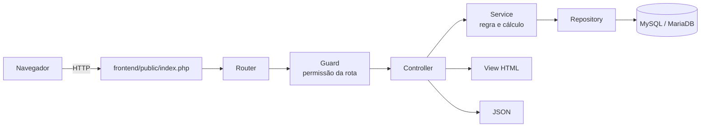

# Plataform Stores

Sistema web **multi-loja** em PHP: numa única instalação convivem várias lojas, cada uma com **vitrine pública** (catálogo, carrinho, checkout), **painel administrativo** (PDV, estoque, entregas, equipe) e o **Analyzing BI**, módulo de indicadores de Matemática Financeira.

A arquitetura é em camadas (**rotas → Guard → controllers → services → repositórios**, PDO no MySQL/MariaDB). **A aplicação roda sem Composer**: o `backend/bootstrap.php` registra o autoload das classes `App\` sozinho. O `composer.json` existe só para as ferramentas de desenvolvimento (PHPStan, php-cs-fixer).

A documentação acadêmica do projeto está em [DOCUMENTACAO.md](DOCUMENTACAO.md).

---

## Índice

1. [O que o sistema faz](#o-que-o-sistema-faz)
2. [Arquitetura](#arquitetura)
3. [Estrutura de pastas](#estrutura-de-pastas)
4. [Instalação](#instalação)
5. [Configuração](#configuração)
6. [Rotas e API](#rotas-e-api)
7. [Usuários, permissões e segurança](#usuários-permissões-e-segurança)
8. [Banco de dados](#banco-de-dados)
9. [Testes e ferramentas](#testes-e-ferramentas)
10. [Arquivos estáticos e uploads](#arquivos-estáticos-e-uploads)
11. [Problemas comuns](#problemas-comuns)
12. [Produção](#produção)

---

## O que o sistema faz

| Área | Endereço | Conteúdo |
|------|----------|----------|
| **Plataforma** | `/`, `/lojas`, `/criar-conta`, `/criar-loja`, `/minha-conta` | Login, lista de lojas, cadastro, criação de loja, conta (com exclusão bloqueada se houver pedidos ou caixa ligados a ela) |
| **Vitrine** | `/loja/{slug}/…` | Catálogo com banner, categorias e ordenação (mais vendidos, novidades, promoções, preço), produto com cor e tamanho (esgotado por tamanho), preço promocional, carrinho, checkout com cupom e parcelamento no cartão, PIX que pode ser retomado depois, retirada ou entrega, meus pedidos (com cancelamento do que não foi pago), meus endereços |
| **Painel** | `/painel/{slug}/…` | Dashboard, produtos, estoque por variação, histórico de estoque (gerente), entregas com confirmação de pagamento, PDV com caixa por turno, conferência de fechamento e desconto com aprovação do gerente, promoções e pagamentos (gerente), funcionários, hierarquia de cargos, Analyzing BI, configurações |
| **API** | `/api/…` | JSON consumido pelo JavaScript da vitrine e do painel |

Recursos opcionais: **RapidAPI** para a imagem do QR Code PIX (sem chave, o QR é gerado localmente) e **OpenRouter** para o assistente de IA do painel.

---

## Arquitetura



- **`public/index.php`** só inclui `frontend/public/index.php`, para manter URLs como `…/plataform_stores/public/` no XAMPP. O `index.php` da raiz redireciona para `public/`.
- **`frontend/public/index.php`** é o front controller: serve estáticos, inicia a sessão, carrega as rotas e despacha.
- As fórmulas financeiras ficam isoladas em `backend/app/Domain/Finance/` (rateio, tendência, tabela Price) e em `AnalyzingBIService` / `AnalyzingBIRepository`.

---

## Estrutura de pastas

```
plataform_stores/
├── backend/
│   ├── bootstrap.php            # .env, constantes PLATAFORM_*, autoload App\
│   ├── app/
│   │   ├── Auth/                # Permissions (matriz por cargo), RateLimiter
│   │   ├── Controllers/         # páginas + Api/* (JSON)
│   │   ├── Database/            # conexão PDO, transação, backup
│   │   ├── Domain/              # Finance/ (Money, Trend, Installments), Product/
│   │   ├── Helpers/functions.php
│   │   ├── Http/Guard.php       # autorização antes do controller
│   │   ├── Payment/             # validação de cartão (Luhn)
│   │   ├── Repositories/        # SQL
│   │   ├── Services/            # regra de negócio
│   │   ├── Support/QrCode.php   # gerador de QR local
│   │   └── Router.php
│   ├── config/                  # app.php, database.php, regrasIA.txt
│   ├── database/                # schema.sql + migrations/
│   ├── routes/                  # web.php, api.php
│   ├── scripts/                 # migrate, backup, seed
│   ├── tests/                   # runner próprio + Unit/
│   ├── tools/                   # verificações contra banco/HTTP e benchmark
│   └── views/                   # plataforma, store/*, panel/*
├── frontend/public/
│   ├── index.php                # front controller
│   ├── static.php               # entrega de assets e uploads com cache
│   ├── assets/                  # css/app.css, js/*, images/, favicon
│   └── uploads/                 # produtos, banners e ícones das lojas
├── public/                      # ponte para frontend/public (XAMPP)
├── storage/                     # logs/ e backups/ (não versionados)
├── .github/workflows/ci.yml
├── DOCUMENTACAO.md
└── README.md
```

---

## Instalação

Requisitos: PHP 8.0+ (`pdo_mysql`, `json`, `session`, `fileinfo`), MySQL 5.7+ ou MariaDB, Apache com `mod_rewrite` (o XAMPP já atende).

1. Copie a pasta para o `htdocs`.
2. Crie o banco:

   ```
   mysql -u root < backend/database/schema.sql
   ```

   O `schema.sql` é o retrato do schema até a migração 0020 e as registra como aplicadas. Em seguida rode `php backend/scripts/migrate.php` para aplicar as posteriores (0021: reserva de estoque, cupons, preço promocional, parcelamento, conferência de caixa e aprovação de desconto; 0022: vendas do PDV como entregues). **Não execute o `schema.sql` em um banco que já tem dados** (ele contém `DROP TABLE IF EXISTS`); nesse caso use só o `migrate.php`.
3. Copie `.env.example` para `.env` e preencha.
4. Ajuste o `RewriteBase` em `public/.htaccess` para o caminho depois do `htdocs` (ex.: `/plataform_stores/public/`).
5. Garanta permissão de escrita em `frontend/public/uploads/` e `storage/`.
6. Opcional: popule com uma loja de exemplo.

   ```
   php backend/scripts/seed.php
   ```

   Cria uma loja com produtos, categorias, metas e três contas (`gerente@loja.test`, `funcionario@loja.test`, `cliente@loja.test`) com a senha `gerente123`. **Troque essas senhas** antes de expor a instalação.
7. Acesse `http://localhost/plataform_stores/public/`.

---

## Configuração

### `.env` (raiz)

| Variável | Função |
|----------|--------|
| `APP_DEBUG` | `true` mostra mensagens de exceção. **`false` fora de desenvolvimento** |
| `APP_URL` | URL base pública (usada quando não dá para inferir pela requisição, como no CLI) |
| `DB_NAME`, `DB_HOST`, `DB_USER`, `DB_PASSWORD` | Sobrescrevem `backend/config/database.php` |
| `RAPIDAPI_KEY` | Imagem do QR Code PIX (opcional) |
| `OPENROUTER_API_KEY`, `OPENROUTER_MODEL`, … | Assistente de IA do painel (opcional) |

O `.env` é ignorado pelo Git e bloqueado por HTTP. As regras do assistente de IA ficam em `backend/config/regrasIA.txt`.

---

## Rotas e API

Páginas em [backend/routes/web.php](backend/routes/web.php); API em [backend/routes/api.php](backend/routes/api.php).

| Grupo | Exemplos |
|-------|----------|
| Carrinho e checkout | `POST …/cart/sync`, `…/checkout/addresses` |
| Loja | `…/pix-config`, `…/banner`, `…/store-icon`, `…/store/appearance` |
| Catálogo | `…/products`, imagens, estoque por variação, categorias da vitrine |
| Pedidos e entregas | `…/orders`, estágios de entrega, `…/orders/vendas`, `…/orders/{id}/estornar` |
| Clientes | `…/clientes` |
| Pagamentos | `POST …/payments`, confirmação, pendentes |
| Caixa e PDV | abrir/fechar turno, movimentos, resumo, `…/finance/installments` (tabela Price) |
| Analyzing BI | `…/analyzing-bi`, `…/analyzing-bi/faturamento`, `…/analyzing-bi/indicadores` |
| Metas | `…/goals`, meta da loja e por funcionário (o funcionário recebe só a própria linha; o rateio divide o valor informado, não a meta inteira) |
| Equipe | usuários, cargos, hierarquia |
| Assistente de IA | `…/ai/chat`, `…/ai/descricao-produto` |

Erros da API voltam em JSON com o campo `error`.

---

## Regras de venda

- **Reserva de estoque.** Pedido online pendente segura as peças: 30 min para escolher o pagamento e pagar o PIX, 3 dias quando o cartão é pago na retirada. Vencido o prazo, o pedido é cancelado sozinho e o estoque volta para a venda (`OrderService::expirarPendentes`). O PDV e a vitrine já mostram o disponível sem as reservas (`StockReservation`).
- **Pagamento.** O gerente confirma PIX e cartão na retirada em *Entregas › Aguardando pagamento*. Cartão com entrega é confirmado na hora, com parcelamento pela regra da loja (sem juros até N parcelas; acima, tabela Price — `InstallmentPlan`).
- **Entregas.** Só pedido pago entra no quadro e as etapas só avançam. Venda de balcão já sai como entregue.
- **Estorno.** Em *Vendas*, o gerente estorna o pedido pago inteiro, com motivo, e escolhe se as peças voltam ao estoque. A venda sai da receita e do lucro do mês em que aconteceu. O sistema só registra: PIX e cartão são devolvidos por fora; dinheiro do balcão sai do caixa aberto.
- **Código de barras.** Cada produto e cada variação podem ter um código (EAN ou SKU), único na loja. No PDV, o leitor digita o código no campo de busca e tecla Enter.
- **Descontos.** Preço promocional e cupons são do gerente (*Promoções*). No PDV, desconto dado por funcionário vira um pedido que o gerente aprova ou recusa em qualquer tela do painel; a aprovação vale uma vez, para aquele subtotal e aquele desconto.
- **Histórico de estoque.** Toda entrada, venda e ajuste (inclusive a reposição pela matriz cor × tamanho) gera movimentação com o responsável. Só o gerente consulta e exporta (CSV).
- **Tema.** A vitrine segue a cor de fundo da loja (fundo escuro = tema escuro), sem botão de tema; painel e plataforma têm claro/escuro. Os ícones de categoria são servidos pelo próprio projeto (funcionam sem internet).

## Usuários, permissões e segurança

**Identidade única:** uma pessoa, uma conta, uma senha. `users.email` é único; o cargo é o vínculo com a loja em `store_members (user_id, store_id, role)`. A mesma pessoa pode ser gerente de uma loja e funcionária de outra. Excluir alguém da equipe desfaz o vínculo, não apaga a conta.

**Permissões:** matriz em [backend/app/Auth/Permissions.php](backend/app/Auth/Permissions.php). O gerente gerencia a loja; o funcionário a opera.

| Área | Gerente | Funcionário |
|------|:-------:|:-----------:|
| Dashboard, PDV, caixa, entregas | ✔ | ✔ |
| Ver catálogo, estoque, pedidos, cargos | ✔ | ✔ (sem o custo dos produtos) |
| Ver metas | ✔ | só a própria |
| Criar/editar produto, ajustar estoque, categorias | ✔ | — |
| Equipe, gestão de cargos, definir metas | ✔ | — |
| Analyzing BI, faturamento e lucro (também no assistente de IA), configurações, chave PIX | ✔ | — |
| Vendas e estornos, clientes | ✔ | — |
| Confirmar pagamento | ✔ | só dinheiro no PDV |

Toda rota declara a permissão no terceiro elemento do handler, e o `App\Http\Guard` decide antes do controller. **Rota sem declaração não executa.**

```php
'POST /api/loja/{slug}/products' => [ProductApiController::class, 'create', 'store.catalog.write'],
'GET /loja/{slug}'               => [StoreFrontController::class, 'vitrine', Guard::PUBLICO],
```

Esconder botão na view (`user_can(...)`) não é proteção; quem decide é o Guard.

- **CSRF:** todo `POST`/`PUT`/`PATCH`/`DELETE` exige token. Formulários usam `csrf_field()`; no JavaScript, `assets/js/csrf.js` intercepta o `fetch` e envia o cabeçalho sozinho.
- **Sessão:** cookie `httponly`/`samesite=Lax`, id renovado no login e no logout. A identidade do comprador vem sempre da sessão.
- **Limite de tentativas** (`App\Auth\RateLimiter`): 8 logins por IP+e-mail a cada 15 minutos, 5 contas por IP por hora, 30 perguntas ao assistente por usuário a cada 10 minutos.
- **Comprovante do pedido:** abre para a equipe da loja, para o dono logado ou para quem tiver o link com `?t={access_token}`.

---

## Banco de dados

| Situação | Comando |
|----------|---------|
| Instalação nova | `mysql -u root < backend/database/schema.sql` |
| Banco existente | `php backend/scripts/migrate.php` (faz backup antes, se houver dados) |
| Ver o que falta | `php backend/scripts/migrate.php --status` |
| Backup manual | `php backend/scripts/backup.php [rótulo]` |

**Migração nova:** crie `backend/database/migrations/NNNN_descricao.sql` com o próximo número (a ordem é alfabética). Não use `DELIMITER`; para DDL condicional use `SET @sql = IF(...); PREPARE …` (veja `0007_stores_banner_path.sql`). Depois, atualize o `schema.sql` e registre a migração na tabela `schema_migrations` dele, para que os dois caminhos continuem iguais.

O XAMPP não tem `log_bin` ligado: **não há como desfazer um `DROP`**. Faça backup antes de qualquer operação destrutiva.

---

## Testes e ferramentas

| Comando | O que faz |
|---------|-----------|
| `php backend/tests/lint.php` | Sintaxe de todo o PHP e JS |
| `php backend/tests/run.php [filtro]` | Testes de unidade (carrinho, cartão, PIX, QR, estoque, fórmulas financeiras). Não precisa de banco |
| `php backend/tools/routes_check.php` | Toda rota declara uma permissão válida |
| `php backend/tools/concurrency_check.php` | Estoque e confirmação de pagamento sob concorrência, contra o banco |
| `php backend/tools/authz_check.php [url]` | Matriz de permissões e CSRF por HTTP (precisa do seed e do servidor no ar) |
| `php backend/tools/identity_check.php [url]` | Identidade única e vínculos por loja |
| `php backend/tools/bi_benchmark.php` | Gera 50 mil pedidos num banco separado, confere o BI e mede o tempo das consultas |
| `php backend/tools/seed_bi_demo.php --loja=slug` | Histórico de vendas de demonstração para o BI (`--remover` desfaz) |

O GitHub Actions ([.github/workflows/ci.yml](.github/workflows/ci.yml)) roda sintaxe e unidade em PHP 8.0 e 8.3, a integração contra um MariaDB limpo e o PHPStan.

Teste novo: crie `backend/tests/Unit/AlgumaCoisaTest.php`, estenda `Tests\TestCase` e comece os métodos com `test`.

---

## Arquivos estáticos e uploads

Servidos por `frontend/public/static.php`, antes do `session_start()` (senão a sessão força `Cache-Control: no-store` em tudo). As URLs saem de `asset()` com `?v=<mtime>`, o que permite cache de um ano: editar o arquivo muda a URL.

- CSS e JS: `frontend/public/assets/` (um único `app.css`, tema claro/escuro por variáveis CSS).
- Uploads: `frontend/public/uploads/` (`products/`, `store-banners/`, `store-icons/`); o banco guarda o caminho relativo.

Se o `DocumentRoot` apontar para `frontend/public/`, o Apache serve os estáticos direto.

---

## Problemas comuns

| Sintoma | O que verificar |
|---------|-----------------|
| 404 nas rotas | `mod_rewrite`, `AllowOverride` e `RewriteBase` |
| Login não redireciona | `localhost` × `127.0.0.1` misturados com `APP_URL` |
| Erro de banco | MySQL ligado, `.env`/`database.php`, migrações aplicadas |
| Imagens não gravam | Permissão de escrita em `frontend/public/uploads/` |
| JSON da API inválido | Warning do PHP na resposta; ver `storage/logs/` |

---

## Produção

- HTTPS, senhas fortes no banco e `APP_DEBUG=false`.
- Aponte o `DocumentRoot` para `frontend/public/`. Dentro do `htdocs`, quem protege `.env`, `backend/`, `storage/` e `.git/` são os `.htaccess`; em outro servidor (nginx) ou sem `AllowOverride`, essa proteção some.
- **O pagamento é simulado.** Um cartão que passa no Luhn marca o pedido como pago. Antes de cobrança real, integre um provedor de pagamento.
- **PIX:** o *copia e cola* é gerado localmente e a confirmação é manual, pelo gerente.
- Revise backups, permissões de arquivo e LGPD antes de uso real.

Projeto acadêmico, oferecido como está.
